# Day-3: Convolutional Neural Networks (CNN)

Notes on what a CNN is, where it came from, how it is built, and why we use it for images instead of a plain ANN. These are expanded from the keywords in [learn.txt](learn.txt).

## Contents

1. [Where CNN fits in deep learning](#1-where-cnn-fits-in-deep-learning)
2. [What is a CNN?](#2-what-is-a-cnn)
3. [ANN vs CNN: matrix multiplication vs convolution](#3-ann-vs-cnn-matrix-multiplication-vs-convolution)
4. [History: LeNet-5 (1998)](#4-history-lenet-5-1998)
5. [CNN architecture](#5-cnn-architecture)
6. [Filters (kernels) and edge detection](#6-filters-kernels-and-edge-detection)
7. [The maths behind each layer](#7-the-maths-behind-each-layer)
8. [Backpropagation in a CNN](#8-backpropagation-in-a-cnn)
9. [Why not use an ANN for images?](#9-why-not-use-an-ann-for-images)
10. [The overfitting problem](#10-the-overfitting-problem)
11. [Data augmentation](#11-data-augmentation)
12. [Famous CNN architectures and Keras Applications](#12-famous-cnn-architectures-and-keras-applications)
13. [Transfer learning](#13-transfer-learning)
14. [Project: image classification](#14-project-image-classification)
15. [Key terms](#15-key-terms)
16. [References](#16-references)

All photos in this page are in [images/](images/) and are generated from the Day-2 sample pictures by [make_figures.py](make_figures.py). Run `python make_figures.py` inside `Day-3/` to rebuild them.

Hands-on notebook: **[filters_demo.ipynb](filters_demo.ipynb)**: RGB vs BGR, colour channels, the Sobel filter, and convolution written from scratch and checked against `cv2.filter2D`.

---

## 1. Where CNN fits in deep learning

Deep learning has three main network families. Each one suits a different shape of data.

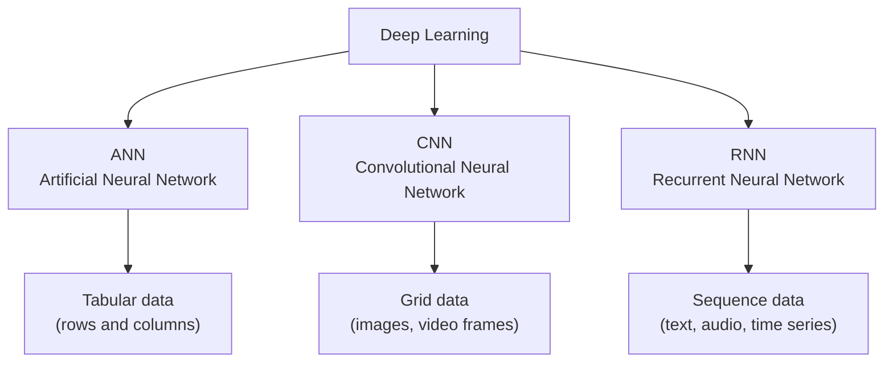

| Network | Best for | Core operation |
|---------|----------|----------------|
| ANN | Tabular data, simple features | Matrix multiplication (every input connects to every neuron) |
| CNN | Images, video, anything laid out on a grid | Convolution (a small filter slides over the input) |
| RNN | Sequences where order matters | Recurrence (output of the last step feeds the next step) |

The main job of a CNN is **feature extraction**: it learns by itself which edges, textures, and shapes matter, so we don't have to hand-design them.

---

## 2. What is a CNN?

A **Convolutional Neural Network** is a neural network designed for data with a **grid-like topology**.

An image is a grid of pixels:

- A grayscale image is a 2D grid: `height × width`.
- A colour image is a 3D grid: `height × width × 3` (one layer each for B, G, R in OpenCV, or R, G, B elsewhere).

```
Grayscale 5×5 image (each number = pixel brightness 0–255)

  ┌─────┬─────┬─────┬─────┬─────┐
  │  12 │  40 │  45 │  38 │  10 │
  ├─────┼─────┼─────┼─────┼─────┤
  │  35 │ 200 │ 210 │ 190 │  30 │
  ├─────┼─────┼─────┼─────┼─────┤
  │  40 │ 220 │ 255 │ 205 │  42 │
  ├─────┼─────┼─────┼─────┼─────┤
  │  33 │ 195 │ 215 │ 188 │  29 │
  ├─────┼─────┼─────┼─────┼─────┤
  │  11 │  38 │  44 │  36 │   9 │
  └─────┴─────┴─────┴─────┴─────┘
        a bright blob in the middle
```

In a grid, a pixel's **neighbours** carry meaning. A pixel on its own says almost nothing; a group of neighbouring pixels forms an edge, a corner, an eye, a wheel. A CNN is built to look at small neighbourhoods and keep that spatial structure.

CNNs learn features in a hierarchy:

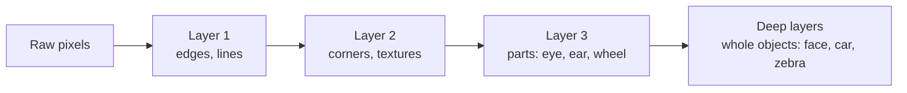

---

## 3. ANN vs CNN: matrix multiplication vs convolution

**ANN → matrix multiplication.** The image is flattened into one long vector, and every pixel connects to every neuron in the next layer (a *fully connected* or *dense* layer):

```
output = activation(W · x + b)
```

**CNN → convolution.** A small matrix of weights called a **kernel** (or **filter**), for example 3×3, slides across the image. At each position it multiplies the overlapping pixels by the kernel values and adds them up. The same kernel is reused at every position.

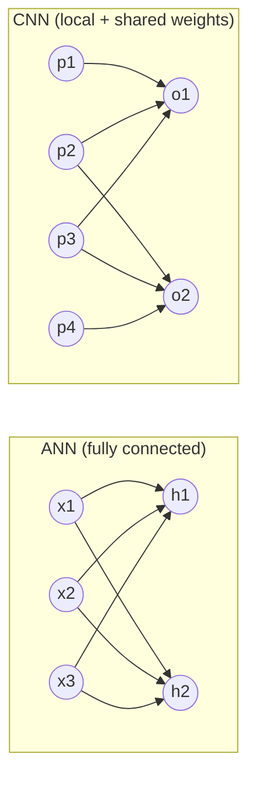

| | ANN | CNN |
|---|-----|-----|
| Operation | Matrix multiplication | Convolution |
| Connections | Every input to every neuron | Each output looks at a small local patch |
| Weights | A separate weight for every connection | The same kernel is shared across the whole image |
| Input shape | Must be flattened to 1D | Keeps the 2D/3D grid |
| Spatial info | Lost when flattening | Kept |
| Parameters for images | Huge | Small |

Two ideas make CNNs efficient:

- **Local connectivity**: each neuron only sees a small patch (its *receptive field*).
- **Weight sharing**: one 3×3 kernel has 9 weights, whether the image is 28×28 or 4000×3000. An edge detector that works in the top-left corner also works in the bottom-right.

---

## 4. History: LeNet-5 (1998)

- **Who**: **Yann LeCun**, with Léon Bottou, Yoshua Bengio, and Patrick Haffner.
- **Where**: **AT&T Bell Labs**.
- **When**: published in **1998** in the paper *"Gradient-Based Learning Applied to Document Recognition"*. LeCun's earlier convolutional networks date back to 1989.
- **What for**: **document recognition**: reading handwritten **digits** (ZIP codes, bank cheques) and other characters such as **letters**.
- **Network**: **LeNet-5**, one of the first CNNs used in real products. It was used to read cheques in US banks. The "5" is usually explained as its 5 main learnable layers (C1, C3, C5, F6, output); counting the pooling layers it has 7.

### LeNet-5 architecture

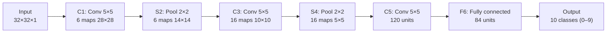

| Layer | Type | Output size |
|-------|------|-------------|
| Input | Grayscale image | 32 × 32 × 1 |
| C1 | Convolution, 6 filters of 5×5 | 28 × 28 × 6 |
| S2 | Subsampling (average pooling) 2×2 | 14 × 14 × 6 |
| C3 | Convolution, 16 filters of 5×5 | 10 × 10 × 16 |
| S4 | Subsampling 2×2 | 5 × 5 × 16 |
| C5 | Convolution, 120 filters of 5×5 | 1 × 1 × 120 |
| F6 | Fully connected | 84 |
| Output | 10 classes | 10 |

LeNet-5 has about **60,000 parameters**. Modern networks follow the same basic pattern of convolution → pooling → fully connected, just much deeper.

---

## 5. CNN architecture


*From the lecture: an image of a zebra goes through Convolution + ReLU and Pooling blocks (feature extraction), then a Flatten layer and Fully Connected layers (classification), and finally Softmax gives probabilities for Horse, Zebra, and Dog.*

A CNN has three building blocks:

1. **Convolution layer** (+ ReLU)
2. **Pooling layer**
3. **Fully connected (FC) layer**

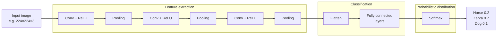

| Stage | Layers | What it does |
|-------|--------|--------------|
| **Feature extraction** | Convolution + ReLU, Pooling (repeated) | Finds edges, textures, shapes, and object parts. Produces **feature maps**. |
| **Classification** | Flatten, Fully connected | Turns the feature maps into a single vector and decides which class the features match. |
| **Probabilistic distribution** | Softmax | Converts raw scores into probabilities that add up to 1. |

### 5.1 Convolution layer

- A **kernel** slides over the image and produces a **feature map**.
- Each kernel learns to detect one pattern (a vertical edge, a curve, a colour blob).
- A layer usually has many kernels (32, 64, 128…), so it outputs many feature maps stacked together.
- **ReLU** is applied after each convolution to add non-linearity.

### 5.2 Pooling layer

- Shrinks each feature map, usually by half.
- **Max pooling** keeps the largest value in each window; **average pooling** keeps the mean.
- Fewer numbers means less computation and fewer parameters later on.
- Gives some **translation invariance**: if the object moves by a pixel or two, the pooled output barely changes.
- Has **no learnable weights**.

### 5.3 Flatten layer

- Unrolls the final stack of feature maps into one long 1D vector so it can feed a dense layer.
- Example: `7 × 7 × 64` → vector of `3136` numbers.

### 5.4 Fully connected (FC) layer

- A normal ANN layer: every input connects to every neuron.
- Combines the extracted features to make the final decision.

### 5.5 Softmax output

- The last layer has one neuron per class.
- Softmax turns its raw scores into probabilities, for example `Horse 0.2, Zebra 0.7, Dog 0.1`, and the class with the highest probability is the prediction.

### 5.6 Padding and stride

Two settings control how a convolution moves over the image:

- **Padding**: a border of zeros around the input. `"valid"` = no padding (output shrinks), `"same"` = enough padding that the output keeps the input size.
- **Stride**: how many pixels the kernel jumps each step. Stride 1 looks at every position; stride 2 skips every other one and halves the output.

Both show up in the output size formula in [section 7.2](#72-output-size-formula), with a picture.

### One block on a real photo

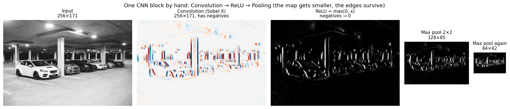

*Convolution finds the vertical edges (red = positive, blue = negative), ReLU throws away the negatives, and each max pooling halves the size while keeping the strongest edges.*

---

## 6. Filters (kernels) and edge detection

### 6.1 What is a filter?

A **filter** (or **kernel**) is a small matrix of numbers, usually **3×3**, **5×5**, or **7×7**. It slides over the image, and at every position it multiplies the pixels under it by its numbers and adds them up (see the worked example in [section 7.1](#71-convolution-worked-example)).

The numbers inside the filter decide what it detects:

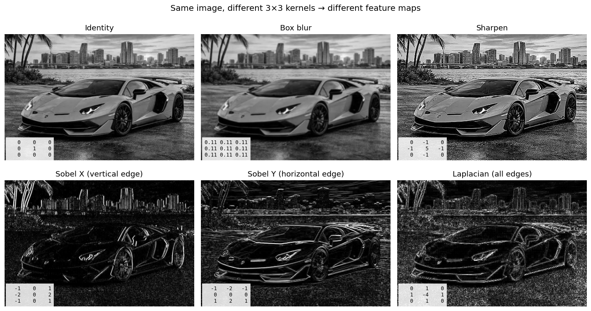

| Filter | What it does |
|--------|--------------|
| Identity | Returns the image unchanged |
| Box blur | Averages neighbours, smooths noise |
| Sharpen | Boosts the centre pixel against its neighbours |
| Sobel X | Finds **vertical** edges (left-right brightness change) |
| Sobel Y | Finds **horizontal** edges (top-bottom brightness change) |
| Laplacian | Finds edges in every direction |

### 6.2 Sobel edge filter

The Sobel filter is a classic hand-designed edge detector. It comes as a pair:

```
Vertical edge detection (Gx)     Horizontal edge detection (Gy)
    ┌────┬───┬────┐                  ┌────┬────┬────┐
    │ -1 │ 0 │ +1 │                  │ -1 │ -2 │ -1 │
    ├────┼───┼────┤                  ├────┼────┼────┤
    │ -2 │ 0 │ +2 │                  │  0 │  0 │  0 │
    ├────┼───┼────┤                  ├────┼────┼────┤
    │ -1 │ 0 │ +1 │                  │ +1 │ +2 │ +1 │
    └────┴───┴────┘                  └────┴────┴────┘
  left column vs right column      top row vs bottom row
```

- **Gx** subtracts the left column from the right column. On a flat area the result is about 0; where brightness jumps from left to right (a vertical edge) the result is large.
- **Gy** does the same for top versus bottom, so it lights up on horizontal edges.
- The middle row/column is weighted ×2, which gives a little smoothing against noise.
- The total edge strength is `G = √(Gx² + Gy²)`.

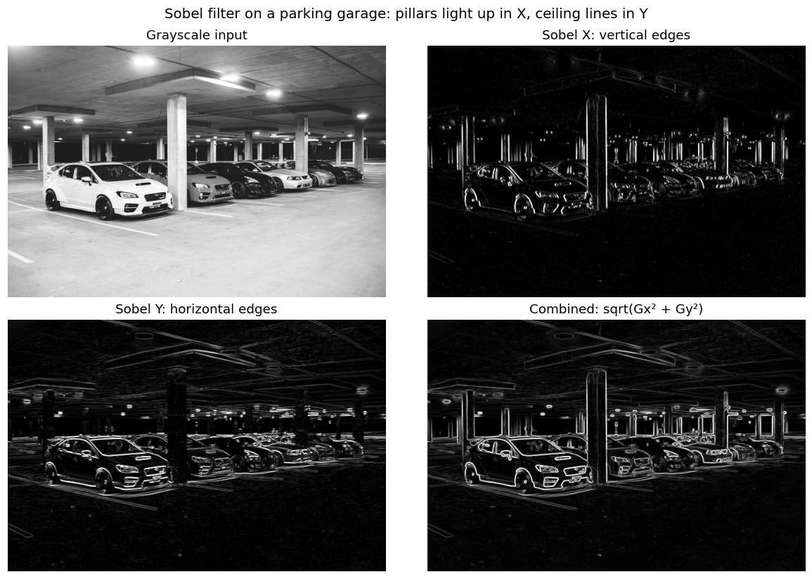

*Sobel X picks out the pillars (vertical), Sobel Y picks out the ceiling beams and car outlines (horizontal), and the combined map shows all edges.*

With OpenCV:

```python
import cv2
import numpy as np

gray = cv2.imread("../Day-2/data/p2.jpg", cv2.IMREAD_GRAYSCALE)
gx = cv2.Sobel(gray, cv2.CV_64F, 1, 0, ksize=3)   # vertical edges
gy = cv2.Sobel(gray, cv2.CV_64F, 0, 1, ksize=3)   # horizontal edges
edges = cv2.magnitude(gx, gy)
```

### 6.3 Hand-made filters vs learned filters

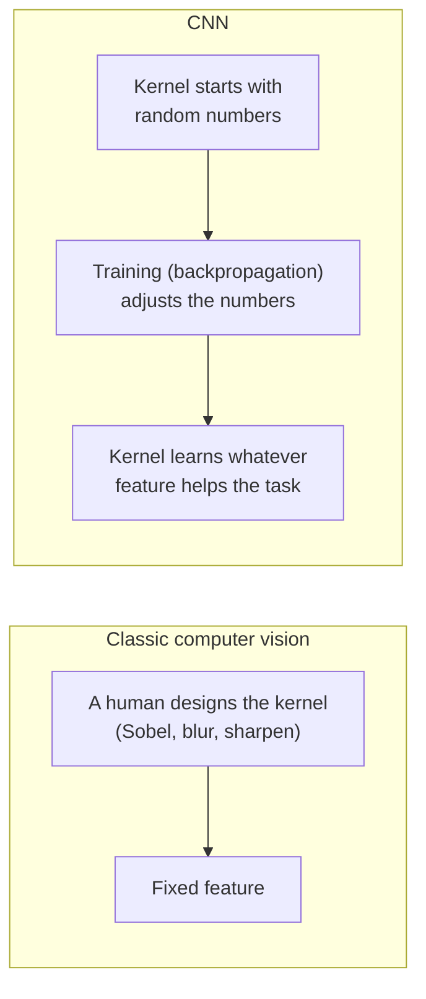

The first layer of a trained CNN often ends up with kernels that look a lot like Sobel edge detectors, but nobody told it to: it found them because edges are useful. Deeper layers learn kernels no human would design by hand.

---

## 7. The maths behind each layer

### 7.1 Convolution (worked example)

A 5×5 input and a 3×3 **vertical edge** kernel:

```
Input (5×5)              Kernel (3×3)
┌───┬───┬───┬───┬───┐    ┌────┬───┬────┐
│ 1 │ 2 │ 0 │ 1 │ 3 │    │  1 │ 0 │ -1 │
├───┼───┼───┼───┼───┤    ├────┼───┼────┤
│ 0 │ 1 │ 3 │ 1 │ 0 │    │  1 │ 0 │ -1 │
├───┼───┼───┼───┼───┤    ├────┼───┼────┤
│ 2 │ 1 │ 0 │ 2 │ 1 │    │  1 │ 0 │ -1 │
├───┼───┼───┼───┼───┤    └────┴───┴────┘
│ 1 │ 0 │ 1 │ 3 │ 2 │
├───┼───┼───┼───┼───┤
│ 0 │ 2 │ 1 │ 0 │ 1 │
└───┴───┴───┴───┴───┘
```

Place the kernel on the top-left 3×3 patch, multiply element by element, and add:

```
(1×1) + (2×0) + (0×-1)
+ (0×1) + (1×0) + (3×-1)
+ (2×1) + (1×0) + (0×-1)
= 1 + 0 + 0 + 0 + 0 - 3 + 2 + 0 + 0 = 0
```

Slide one step right and repeat, then move down a row. The full output (feature map) is:

```
Output (3×3)
┌────┬────┬────┐
│  0 │  0 │ -1 │
├────┼────┼────┤
│ -1 │ -4 │  1 │
├────┼────┼────┤
│  1 │ -2 │ -2 │
└────┴────┴────┘
```

Strictly speaking, deep learning libraries compute *cross-correlation* (they don't flip the kernel), but everyone calls it convolution.

Try it yourself with NumPy:

```python
import numpy as np

image = np.array([[1, 2, 0, 1, 3],
                  [0, 1, 3, 1, 0],
                  [2, 1, 0, 2, 1],
                  [1, 0, 1, 3, 2],
                  [0, 2, 1, 0, 1]])
kernel = np.array([[1, 0, -1],
                   [1, 0, -1],
                   [1, 0, -1]])

out = np.zeros((3, 3), dtype=int)
for i in range(3):
    for j in range(3):
        out[i, j] = np.sum(image[i:i+3, j:j+3] * kernel)
print(out)
```

Or on a real image with OpenCV (this connects back to Day-2):

```python
import cv2
import numpy as np

img = cv2.imread("../Day-2/data/image1.jpg", cv2.IMREAD_GRAYSCALE)
kernel = np.array([[1, 0, -1],
                   [1, 0, -1],
                   [1, 0, -1]], dtype=np.float32)
edges = cv2.filter2D(img, -1, kernel)
```

In a CNN, the kernel values are not hand-picked like this. They start random and are **learned** during training.

### 7.2 Output size formula

```
Output size = ⌊(n + 2p − f) / s⌋ + 1
```

| Symbol | Meaning |
|--------|---------|
| `n` | Input size (height or width) |
| `f` | Filter (kernel) size |
| `p` | Padding: extra border of zeros added around the input |
| `s` | Stride: how many pixels the kernel jumps each step |

Examples:

- `n = 5, f = 3, p = 0, s = 1` → `(5 + 0 − 3)/1 + 1 = 3` → 3×3 (the example above)
- `n = 32, f = 5, p = 0, s = 1` → `28` (LeNet-5 layer C1)
- `n = 224, f = 3, p = 1, s = 1` → `224` ("same" padding keeps the size)
- `n = 224, f = 3, p = 1, s = 2` → `112` (stride 2 halves it)

```
Padding p = 1 (zeros around a 3×3 input)   Stride s = 2

  0 0 0 0 0                                  [k k k] . .      . . [k k k]
  0 a b c 0                                  [k k k] . .  →   . . [k k k]
  0 d e f 0                                  [k k k] . .      . . [k k k]
  0 g h i 0                                  kernel jumps 2 pixels each step
  0 0 0 0 0
```

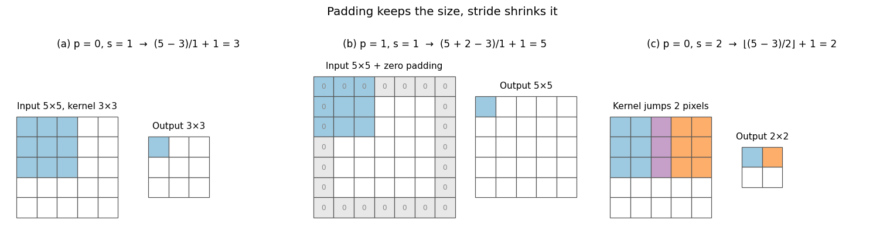

### 7.3 Number of parameters in a convolution layer

```
Parameters = (f × f × C_in + 1) × C_out
```

`C_in` is the number of input channels, `C_out` is the number of filters, and `+1` is the bias for each filter.

Example: 32 filters of 3×3 on an RGB image → `(3 × 3 × 3 + 1) × 32 = 896` parameters. This does not depend on the image size at all.

### 7.4 ReLU activation

```
ReLU(x) = max(0, x)
```

Negative values become 0, positive values stay the same. Applied to the feature map above:

```
[ 0  0 -1]          [0 0 0]
[-1 -4  1]  ReLU →  [0 0 1]
[ 1 -2 -2]          [1 0 0]
```

Without a non-linear function like ReLU, stacking layers would collapse into one big linear function and the network couldn't learn complex shapes.

### 7.5 Max pooling (2×2, stride 2)

```
Input (4×4)                     Output (2×2)
┌───┬───┬───┬───┐
│ 1 │ 3 │ 2 │ 1 │               ┌───┬───┐
├───┼───┼───┼───┤               │ 6 │ 5 │
│ 4 │ 6 │ 5 │ 0 │   max pool    ├───┼───┤
├───┼───┼───┼───┤   ───────→    │ 3 │ 7 │
│ 3 │ 1 │ 1 │ 2 │               └───┴───┘
├───┼───┼───┼───┤
│ 0 │ 2 │ 7 │ 4 │
└───┴───┴───┴───┘
```

Each 2×2 block becomes its largest value: `max(1,3,4,6) = 6`, `max(2,1,5,0) = 5`, `max(3,1,0,2) = 3`, `max(1,2,7,4) = 7`.

### 7.6 Softmax

```
softmax(zᵢ) = e^(zᵢ) / Σⱼ e^(zⱼ)
```

Example: raw scores `[2.0, 1.0, 0.1]` for `[Zebra, Horse, Dog]` → probabilities `[0.66, 0.24, 0.10]`. They add up to 1, and Zebra wins.

---

## 8. Backpropagation in a CNN

A CNN learns the same way an ANN does: guess, measure the mistake, nudge every weight a little to make the mistake smaller, repeat. The difference is **what** the weights are: in a CNN most of them are the numbers inside the kernels.

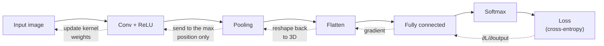

Solid arrows = **forward pass** (make a prediction). Dotted arrows = **backward pass** (send the error back).

### The training loop

1. **Forward pass**: the image goes through every layer and Softmax gives probabilities.
2. **Loss**: compare the prediction with the true label, usually with **cross-entropy**: `L = −log(p_true_class)`. If the model said Zebra 0.7 and the answer is Zebra, `L = −log(0.7) ≈ 0.36`.
3. **Backward pass**: use the chain rule to work out `∂L/∂w` for every weight, starting at the loss and moving backwards.
4. **Update**: gradient descent, `w_new = w − learning_rate × ∂L/∂w`.
5. Repeat for every batch of images, for many epochs.

### How the gradient passes through each layer

| Layer | Learnable weights? | What happens in the backward pass |
|-------|--------------------|-----------------------------------|
| **Fully connected** | Yes (W, b) | Same as a normal ANN layer. |
| **Flatten** | No | Just reshapes the gradient vector back into the 3D feature-map shape. |
| **Max pooling** | No | The gradient goes only to the pixel that was the maximum in each window; the others get 0. |
| **ReLU** | No | Gradient passes through where the input was positive, is blocked (0) where it was negative. |
| **Convolution** | Yes (kernels, biases) | `∂L/∂kernel` = convolution of the **input** with the **incoming gradient**. Because the kernel is shared, its gradient is the **sum** over every position it visited. `∂L/∂input` = "full" convolution of the incoming gradient with the kernel rotated 180°, which is passed to the layer before. |

Max pooling backward, using the example from [section 7.5](#75-max-pooling-22-stride-2):

```
Forward: max of [1 3 / 4 6] = 6        Backward: incoming gradient g for that output
                                        ┌───┬───┐
                                        │ 0 │ 0 │
                                        ├───┼───┤
                                        │ 0 │ g │   ← only the "6" gets it
                                        └───┴───┘
```

In practice you never write this by hand: TensorFlow/Keras and PyTorch compute every gradient automatically (**autograd**) when you call `model.fit(...)` or `loss.backward()`.

---

## 9. Why not use an ANN for images?

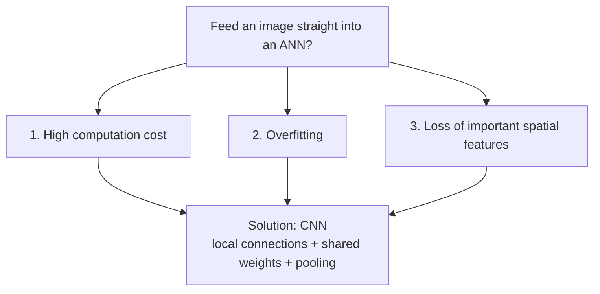

### 9.1 High computation cost

An ANN needs one weight for every pixel-to-neuron connection.

| Image | Input values | Weights for one dense layer of 1,000 neurons |
|-------|--------------|----------------------------------------------|
| 28 × 28 grayscale (MNIST) | 784 | 784,000 |
| 224 × 224 × 3 colour | 150,528 | **150,528,000** (about 150 million) |
| 1920 × 1080 × 3 (Full HD) | 6,220,800 | about 6.2 billion |

Compare: a CNN layer with 64 filters of 3×3 on an RGB image needs only `(3×3×3 + 1) × 64 = 1,792` parameters, whatever the image size.

More weights means more memory, slower training, and slower predictions.

### 9.2 Overfitting

With millions of weights and a limited number of training images, an ANN can simply **memorise** the training images (including their noise and backgrounds) instead of learning general patterns. It then does well on training data and badly on new images. See [section 10](#10-the-overfitting-problem).

### 9.3 Loss of important features (spatial information)

To feed an image into an ANN you must **flatten** it into a 1D vector:

```
2D image                       Flattened vector
┌───┬───┬───┐
│ a │ b │ c │
├───┼───┼───┤        →        [ a  b  c  d  e  f  g  h  i ]
│ d │ e │ f │
├───┼───┼───┤        "b" and "e" were neighbours (one above the other),
│ g │ h │ i │        now they are 3 positions apart. The network no
└───┴───┴───┘        longer knows which pixels were next to each other.
```

- Pixels that were next to each other vertically end up far apart.
- The network has no built-in idea of "neighbour", "edge", or "shape".
- If the object shifts by a few pixels, completely different input neurons light up, so the ANN has to learn the same object at every position separately.

A CNN keeps the grid and looks at neighbourhoods, so it keeps these features.

---

## 10. The overfitting problem

**Overfitting** happens when a model learns the training data too well, including noise and small details that don't generalise. It scores high on training data but low on new, unseen data.

```
Accuracy
  ▲
  │            ________________  training accuracy (keeps rising)
  │          /
  │        /   _____
  │      /   /      \_______    validation accuracy (rises, then falls)
  │    /   /                \___
  │  /   /
  │/   /        ↑
  │  /     overfitting starts here
  └──────────────────────────────────▶ Epochs
```

| | Underfitting | Good fit | Overfitting |
|---|--------------|----------|-------------|
| Training accuracy | Low | High | Very high |
| Test accuracy | Low | High | Low |
| Cause | Model too simple | Right balance | Model too complex / too little data |

### Signs

- Training loss keeps going down but validation loss starts going up.
- Big gap between training accuracy and test accuracy.

### How to reduce overfitting

| Technique | Idea |
|-----------|------|
| **Use a CNN instead of an ANN** | Weight sharing means far fewer parameters to memorise with. |
| **More data** | More examples make memorising harder. |
| **Data augmentation** | Create new training images by flipping, rotating, cropping, zooming, and changing brightness (see [section 11](#11-data-augmentation)). |
| **Dropout** | Randomly switch off some neurons during training so the network can't rely on any single one. |
| **Pooling** | Reduces the size of feature maps and the number of parameters. |
| **L1 / L2 regularisation** | Penalise large weights. |
| **Batch normalisation** | Stabilises training and has a slight regularising effect. |
| **Early stopping** | Stop training when validation loss stops improving. |
| **Transfer learning** | Start from a network already trained on millions of images (see [section 13](#13-transfer-learning)). |

---

## 11. Data augmentation

**Data augmentation** means making new training images from the ones you already have by changing them slightly: flip, rotate, zoom, shift, change the brightness. The label stays the same, since a flipped car is still a car.

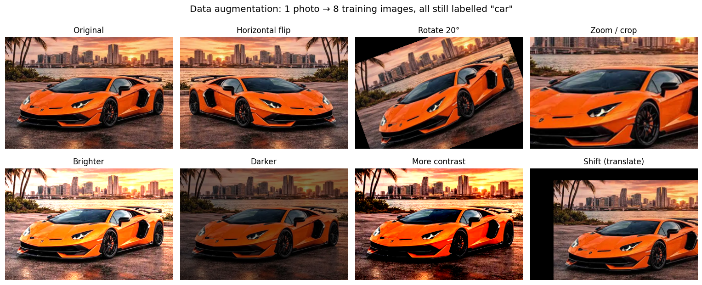

Why it helps:

- The model sees more variety, so it learns "what a car looks like" instead of memorising the exact pixels of each training photo. This **reduces overfitting**.
- It makes the model robust to things that change in real photos: position, angle, lighting, distance.
- It's free: no new photos to collect or label.

| Augmentation | Simulates | Careful when |
|--------------|-----------|--------------|
| Horizontal flip | Object facing the other way | Text, digits (a flipped "3" is not a 3) |
| Vertical flip | Upside-down views | Most everyday photos (cars are rarely upside down) |
| Rotation | Tilted camera | Large angles on digits ("6" ↔ "9") |
| Zoom / crop | Closer or further away | Cropping out the object itself |
| Shift (translate) | Object in a different place | Shifting it off the image |
| Brightness / contrast | Different lighting | Colour is the thing you are classifying |

Augmentation is applied **only to the training set**, randomly, each epoch. Validation and test images stay untouched.

In Keras, augmentation can be a set of layers at the start of the model:

```python
from tensorflow.keras import layers, models

data_augmentation = models.Sequential([
    layers.RandomFlip("horizontal"),
    layers.RandomRotation(0.1),        # up to ±10% of a full turn (±36°)
    layers.RandomZoom(0.2),
    layers.RandomTranslation(0.1, 0.1),
    layers.RandomContrast(0.2),
])

model = models.Sequential([
    layers.Input(shape=(224, 224, 3)),
    data_augmentation,                 # only active during training
    layers.Conv2D(32, 3, activation="relu"),
    # ... rest of the CNN
])
```

---

## 12. Famous CNN architectures and Keras Applications

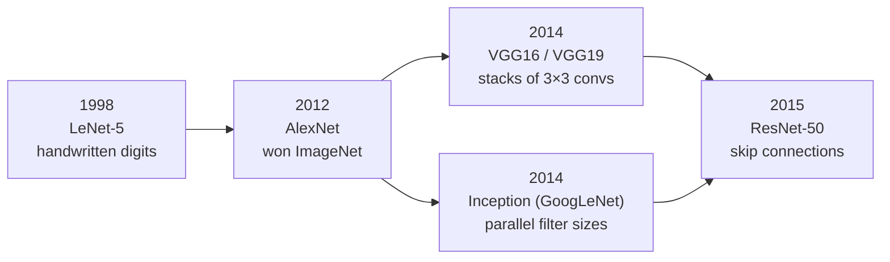

| Model | Year | Depth | Parameters (approx.) | Key idea |
|-------|------|-------|----------------------|----------|
| **LeNet-5** | 1998 | 5 learnable layers | 60 K | First practical CNN, digit recognition |
| **AlexNet** | 2012 | 8 layers | 60 M | ReLU, dropout, trained on GPUs; won ImageNet 2012 |
| **VGG16** | 2014 | 16 layers | 138 M | Only 3×3 convolutions, stacked deep |
| **VGG19** | 2014 | 19 layers | 144 M | Same as VGG16, 3 more conv layers |
| **Inception v1 (GoogLeNet)** | 2014 | 22 layers | 6.8 M | Inception module: 1×1, 3×3, 5×5 filters in parallel |
| **ResNet-50** | 2015 | 50 layers | 25.6 M | Residual (skip) connections: `output = F(x) + x` |

ResNet's skip connection, the idea that made 50+ layer networks trainable:

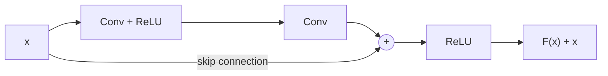

### Keras Applications

[Keras Applications](https://keras.io/api/applications/) gives you these models ready to use, with weights already trained on ImageNet (1.4 million images, 1,000 classes). This is called **transfer learning**.

```python
from tensorflow.keras.applications import ResNet50
from tensorflow.keras.applications.resnet50 import preprocess_input, decode_predictions
from tensorflow.keras.preprocessing import image
import numpy as np

model = ResNet50(weights="imagenet")

img = image.load_img("zebra.jpg", target_size=(224, 224))
x = image.img_to_array(img)
x = np.expand_dims(x, axis=0)
x = preprocess_input(x)

preds = model.predict(x)
print(decode_predictions(preds, top=3)[0])
# e.g. [('n02391049', 'zebra', 0.98), ...]
```

Other models available the same way: `VGG16`, `VGG19`, `InceptionV3`, `MobileNetV2`, `EfficientNetB0`, and more. AlexNet and LeNet-5 are not in Keras Applications, but they are easy to build by hand.

A small LeNet-5-style CNN in Keras:

```python
from tensorflow.keras import layers, models

model = models.Sequential([
    layers.Input(shape=(32, 32, 1)),
    layers.Conv2D(6, kernel_size=5, activation="relu"),   # 28×28×6
    layers.AveragePooling2D(pool_size=2),                 # 14×14×6
    layers.Conv2D(16, kernel_size=5, activation="relu"),  # 10×10×16
    layers.AveragePooling2D(pool_size=2),                 # 5×5×16
    layers.Flatten(),                                     # 400
    layers.Dense(120, activation="relu"),
    layers.Dense(84, activation="relu"),
    layers.Dense(10, activation="softmax"),               # digits 0–9
])
model.summary()
```

---

## 13. Transfer learning

Training a big CNN from scratch needs millions of labelled images and days of GPU time. **Transfer learning** skips most of that: take a model that was already trained on a huge dataset (usually ImageNet), keep what it learned, and retrain only a small part for your own task.

It works because the early layers of any image CNN learn the same general things (edges, textures, shapes, see [section 2](#2-what-is-a-cnn)). Only the last layers are specific to the original 1,000 ImageNet classes.

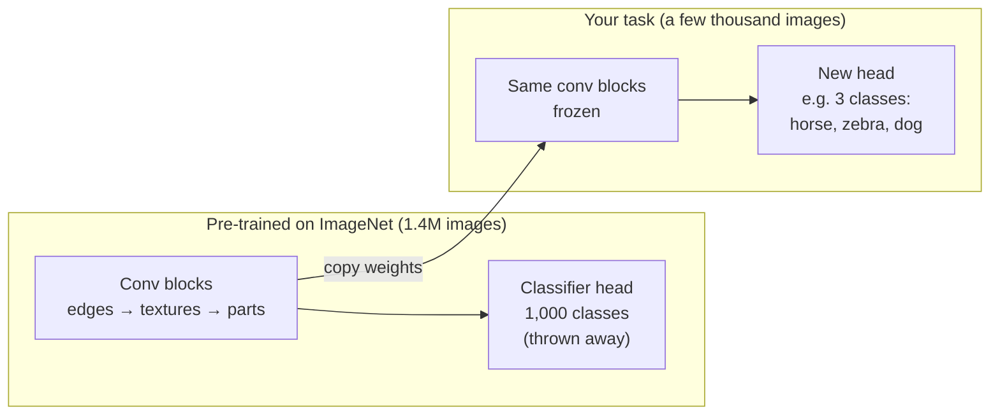

### Two ways to use it

| Approach | What you train | When to use |
|----------|----------------|-------------|
| **Feature extraction** | Only the new head; the base is frozen (`trainable = False`) | Small dataset, similar kind of images to ImageNet |
| **Fine-tuning** | New head first, then unfreeze the top few conv layers and train them with a very small learning rate | More data, or images that look different from ImageNet (X-rays, satellite photos) |

### Why use it

- Good accuracy with **small datasets** (even a few hundred images per class).
- **Much faster** training: only a small part of the network is learning.
- Less **overfitting**, because the frozen layers already hold general features.

### Example: MobileNetV2 as a frozen base

```python
from tensorflow.keras import layers, models
from tensorflow.keras.applications import MobileNetV2

base = MobileNetV2(input_shape=(224, 224, 3), include_top=False, weights="imagenet")
base.trainable = False                      # freeze the pre-trained layers

model = models.Sequential([
    layers.Input(shape=(224, 224, 3)),
    layers.Rescaling(1/127.5, offset=-1),   # MobileNetV2 expects pixels in [-1, 1]
    base,
    layers.GlobalAveragePooling2D(),
    layers.Dropout(0.2),
    layers.Dense(3, activation="softmax"),  # your own classes
])
model.compile(optimizer="adam", loss="sparse_categorical_crossentropy", metrics=["accuracy"])

# Fine-tuning later (optional):
# base.trainable = True
# model.compile(optimizer=tf.keras.optimizers.Adam(1e-5), ...)
```

`include_top=False` is the key part: it drops ImageNet's 1,000-class head so you can attach your own.

---

## 14. Project: image classification

The end goal of this topic: build a CNN that looks at a photo and says which class it belongs to.

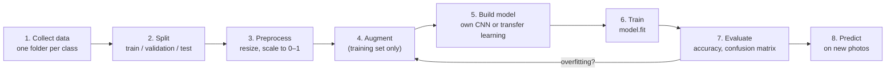

### Folder layout

```
dataset/
├── train/
│   ├── cat/   cat001.jpg, cat002.jpg, ...
│   └── dog/   dog001.jpg, dog002.jpg, ...
└── test/
    ├── cat/
    └── dog/
```

Keras reads the class names from the folder names.

### Minimal code

```python
import tensorflow as tf
from tensorflow.keras import layers, models

train_ds = tf.keras.utils.image_dataset_from_directory(
    "dataset/train", validation_split=0.2, subset="training", seed=42,
    image_size=(128, 128), batch_size=32)
val_ds = tf.keras.utils.image_dataset_from_directory(
    "dataset/train", validation_split=0.2, subset="validation", seed=42,
    image_size=(128, 128), batch_size=32)
num_classes = len(train_ds.class_names)

model = models.Sequential([
    layers.Input(shape=(128, 128, 3)),
    layers.RandomFlip("horizontal"),
    layers.RandomRotation(0.1),
    layers.Rescaling(1/255),
    layers.Conv2D(32, 3, padding="same", activation="relu"),
    layers.MaxPooling2D(),
    layers.Conv2D(64, 3, padding="same", activation="relu"),
    layers.MaxPooling2D(),
    layers.Conv2D(128, 3, padding="same", activation="relu"),
    layers.MaxPooling2D(),
    layers.Flatten(),
    layers.Dropout(0.3),
    layers.Dense(128, activation="relu"),
    layers.Dense(num_classes, activation="softmax"),
])
model.compile(optimizer="adam", loss="sparse_categorical_crossentropy", metrics=["accuracy"])

history = model.fit(
    train_ds, validation_data=val_ds, epochs=20,
    callbacks=[tf.keras.callbacks.EarlyStopping(patience=3, restore_best_weights=True)])
```

Every idea from this page is in that code: convolution + ReLU, padding, pooling, flatten, fully connected, softmax, data augmentation, dropout, and early stopping against overfitting. Swap the Conv2D blocks for a pre-trained base ([section 13](#13-transfer-learning)) and accuracy usually jumps on small datasets.

Good beginner datasets: [MNIST](https://keras.io/api/datasets/mnist/) (digits), [CIFAR-10](https://keras.io/api/datasets/cifar10/) (10 everyday objects), [Cats vs Dogs](https://www.tensorflow.org/datasets/catalog/cats_vs_dogs).

---

## 15. Key terms

| Term | Meaning |
|------|---------|
| **Kernel / Filter** | Small matrix of learnable weights that slides over the image |
| **Feature map** | The output of one kernel applied across the whole image |
| **Receptive field** | The patch of the input that one output value "sees" |
| **Stride** | How many pixels the kernel moves each step |
| **Padding** | Zeros added around the border so the output keeps its size |
| **Channel** | A depth layer of the input, such as R, G, B, or one feature map |
| **Weight sharing** | The same kernel weights are used at every position |
| **Pooling** | Downsampling a feature map (max or average) |
| **Flatten** | Turning a 3D stack of feature maps into a 1D vector |
| **Fully connected (dense)** | Every input connected to every neuron |
| **ReLU** | `max(0, x)` activation |
| **Softmax** | Turns scores into class probabilities that sum to 1 |
| **Overfitting** | Memorising training data instead of learning general patterns |
| **Transfer learning** | Reusing a model pre-trained on a big dataset for a new task |
| **Sobel filter** | Hand-designed 3×3 kernel pair that finds vertical (Gx) and horizontal (Gy) edges |
| **Backpropagation** | Sending the loss gradient backwards through the layers to update every weight |
| **Loss (cross-entropy)** | How wrong the prediction is: `−log(probability of the true class)` |
| **Fine-tuning** | Unfreezing some pre-trained layers and training them with a small learning rate |
| **Epoch** | One full pass over the training data |

---

## 16. References

**Papers**

- LeCun, Bottou, Bengio, Haffner (1998). [Gradient-Based Learning Applied to Document Recognition](http://yann.lecun.com/exdb/publis/pdf/lecun-01a.pdf). The LeNet-5 paper; Figure 2 is the original LeNet-5 diagram.
- Krizhevsky, Sutskever, Hinton (2012). [ImageNet Classification with Deep Convolutional Neural Networks](https://papers.nips.cc/paper/2012/hash/c399862d3b9d6b76c8436e924a68c45b-Abstract.html) (AlexNet).
- Simonyan, Zisserman (2014). [Very Deep Convolutional Networks for Large-Scale Image Recognition](https://arxiv.org/abs/1409.1556) (VGG16/19).
- Szegedy et al. (2014). [Going Deeper with Convolutions](https://arxiv.org/abs/1409.4842) (Inception / GoogLeNet).
- He, Zhang, Ren, Sun (2015). [Deep Residual Learning for Image Recognition](https://arxiv.org/abs/1512.03385) (ResNet).

**Diagrams and visual explanations**

- [CS231n: Convolutional Neural Networks for Visual Recognition](https://cs231n.github.io/convolutional-networks/). Has an animated demo of a kernel sliding over a 3-channel input.
- [CNN Explainer](https://poloclub.github.io/cnn-explainer/). Interactive, in-browser visualisation of every layer of a small CNN.
- [Convolution arithmetic animations (vdumoulin/conv_arithmetic)](https://github.com/vdumoulin/conv_arithmetic). GIFs of padding and stride.
- [Wikipedia: Convolutional neural network](https://en.wikipedia.org/wiki/Convolutional_neural_network). Includes the LeNet vs AlexNet comparison diagram.
- [Yann LeCun's MNIST page](http://yann.lecun.com/exdb/mnist/). The handwritten digit dataset LeNet was tested on.

**Docs**

- [Keras Applications](https://keras.io/api/applications/). Pre-trained models and their sizes and accuracies.
- [Keras Conv2D layer](https://keras.io/api/layers/convolution_layers/convolution2d/).
- [OpenCV `filter2D`](https://docs.opencv.org/4.x/d4/d86/group__imgproc__filter.html). Apply your own kernel to an image.
